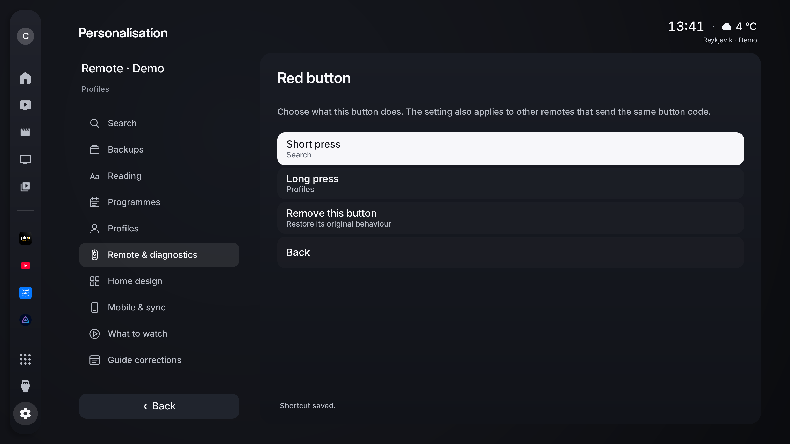
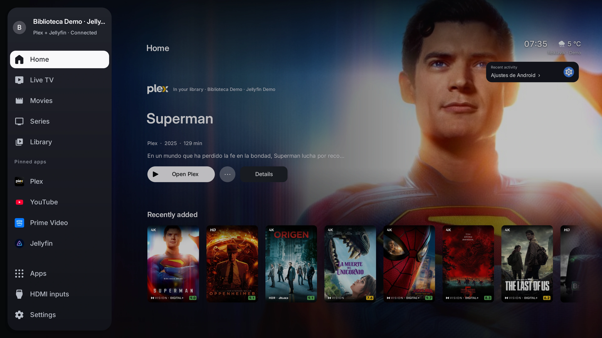
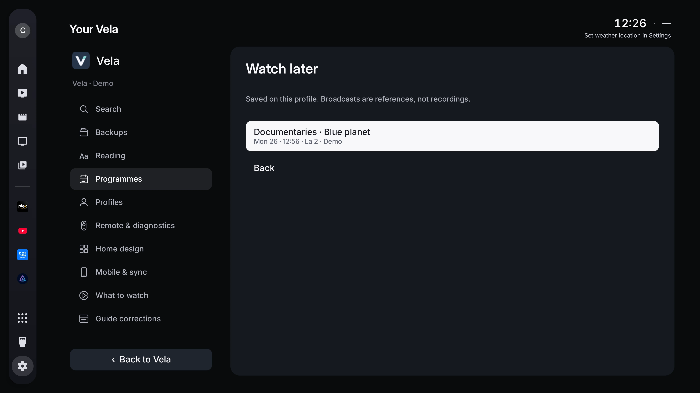

# Vela

### Your library. Your channels. Your television.

A personal home screen for **Android TV and Google TV**. Bring your Plex or Jellyfin library, live channels, apps and HDMI devices together in a calm interface made for your remote.

**[Download Vela](https://github.com/LucasLG92/vela-tv/releases/tag/v1.37.0-preview)** · [Explore the gallery](gallery/README.md) · [Installation](guide/INSTALL.md) · **[Vela Lite](lite/README.md)**

**Android 11+ · English / Español / Português / Français / Deutsch / Italiano · Preview · MIT**

## Your remote, your shortcuts

Give available remote buttons a purpose: open TV, an app, HDMI, Search or Settings with a short press or a long press. Learn each button in the same calm settings interface. Your choices stay private to your profile.

## Pick up your story

Connect **Plex, Jellyfin or both together** and let your own posters and artwork fill the screen. Continue watching shows what you have started, how much time remains and the next available episode. Hold OK to mark one film or episode as watched on your connected server.

Save a film, episode or broadcast to your own **Watch later** list. Each local profile can link its own Plex and Jellyfin accounts.

Platform logos and remaining time stay inside each Continue watching image, leaving room for Recently added as soon as you arrive. Recently added brings your newest films and series home. Open Movies or Series to browse the full library in small pages, with server-backed filters and newest additions first.

| Movies | Series |
| --- | --- |
|  |  |

[Connect Jellyfin](guide/JELLYFIN.md) · [Library filters](guide/LIBRARY-FILTERS.md) · [Continue watching](guide/CONTINUE-WATCHING.md)

## Make room for live television

Your **M3U playlists, Xtream service and television antenna**, in the same Vela interface. Explore a horizontal programme guide or large channel cards. See what is on, how long it has left and what comes next.

Hold OK for channel actions and favourites. Put them in your order, hide channels and categories you do not use, revisit recent channels or return to the previous channel. During playback, press Right to browse without leaving the picture. A quiet information strip shows the channel, progress, clock and next programme; Left opens playback controls when the strip is visible.

The Full edition can try another matching signal when a stream fails. You can correct an EPG match or time offset yourself. What to watch explores Now, Tonight and the next 48 hours, with categories supplied by the guide.

For supported clear HLS streams, enable optional **local pause and rewind**. The selected channel uses one decoder and a bounded private disk buffer, cleared on exit. Past programmes are available only when your source explicitly advertises a compatible archive. Antenna pause depends on your television's tuner.

[Live TV setup and controls](guide/IPTV.md) · [Compatibility and limits](guide/COMPATIBILITY.md)

## Recognise every app

Large, rounded icons make your apps easy to find. A quiet Recent activity shortcut in Apps returns to your last available app, input or channel. Pin more shortcuts to the sidebar, hold OK to rearrange or remove them, and group installed apps into folders. Removing a shortcut keeps the app installed.

Press OK on a pinned app to launch it. Press Right on YouTube to explore the rows it shares with Android TV. Other services can appear in Continue watching when they publish compatible Watch Next information; Vela never imports their private sessions.

## A home that feels like yours

The sidebar opens over a continuous full-screen backdrop, with clear labels and a complete preview of your content. Settings and personalisation stay in the same graphite canvas.

Choose your accent, poster size and background intensity. Arrange, resize or hide home rows. Create local profiles with separate layouts, favourites and library accounts. Add a settings PIN and a separate guest space, adjust reading size and guide density, or set screen margins for your television.

Configure apps, folders and favourites **from your phone** through a temporary local HTTPS session. Explicitly pair another Vela to receive compatible preferences when it opens. Accounts and provider credentials stay on each television, and conflicting local edits are kept for review.

Every menu is available in **English, Spanish, Portuguese, French, German and Italian**. Choose a language in Appearance or follow your TV's system language. Channel names, account names and library titles keep their original text.

Settings and personalisation stay within the main sidebar, with clear categories and the same remote navigation throughout. Use a supported remote search key for voice search, assign an available button in Remote & diagnostics, or open Search in Your Vela. Android may keep control of its Assistant button; Vela uses the recognizer installed on your television.

[Personalisation, phone setup, profiles and sync](guide/YOUR-VELA.md) · [Integrated settings](guide/INTEGRATED-SETTINGS.md) · [Player controls](guide/PLAYER.md)

| Settings that stay in Vela | A list for later |
| --- | --- |
|  |  |

## Your connected devices, in view

HDMI inputs share your home screen's sidebar and visual style. Original brand icons help identify consoles, TV boxes, PCs and Macs when Android reports an active connection. Unknown or disconnected inputs keep their HDMI port name. Hold OK to choose a device profile yourself.

[How HDMI detection works](guide/HDMI.md)

## Let the screen take a breath

Choose aerial landscapes and cities, or artwork from your connected library. Add a quiet clock and weather for your approximate location or chosen city. Library images move gently; Reduce motion keeps them still.

## Two editions, one visual language

| | Vela | Vela Lite |
| --- | --- | --- |
| Designed for | Your main TV or Android TV box | A television used with an HDMI box, console or computer |
| Android | 11+ | 8.0+ |
| Plex / Jellyfin library | Yes | — |
| Live sources | M3U, Xtream, antenna | Antenna |
| Guide, favourites, hidden channels, recent and previous channel | Yes | Yes |
| Apps, folders and HDMI devices | Yes | Yes |
| Phone setup, local profiles, backups and preference sync | Yes | Yes, compatible settings |
| Watch later, settings PIN, guest space and sleep timer | Yes | Yes, broadcasts only in Watch later |
| Screensaver | Aerials or library artwork | Television's own screensaver |
| Optional HLS pause and provider archives | Supported sources | — |
| Tuner pause | When the manufacturer exposes it | When the manufacturer exposes it |

**[Explore Vela Lite →](lite/README.md)**

## Built to stay light

Home artwork and app icons use bounded caches. Libraries and guides are paged, stale work is cancelled, and players are released when you leave. No background video plays on Home. Only the selected language catalogue is loaded; English uses the source text directly.

Optional HLS rewind stores its history on disk, up to 15 minutes, 256 MiB and 240 segments. Its decoder queue has a 4 MiB target; these limits are not a claim about total application RAM. Lite contains no Plex, Jellyfin, IPTV or Media3 engine.

## Updates from your remote

Vela can check GitHub and download updates automatically. APKs are verified for integrity, package identity and signing certificate. Android asks you to confirm installation; installed update files are cleaned from Vela's private cache afterwards. Your explicit update preferences are kept.

## Your data stays yours

Each installation starts with neutral settings. No personal account, IPTV credential or location is bundled. Phone setup stays on your network; backups and sync exclude accounts, tokens, provider URLs, location and viewing history. Public screenshots use demonstration data.

[Privacy](guide/PRIVACY.md) · [Security](SECURITY.md) · [Credits and licences](NOTICE.md)

Vela is a preview. HDMI, native tuning, Home-button behaviour and some playback features depend on what the device and source expose. External services manage their own accounts and playback. See the [compatibility guide](guide/COMPATIBILITY.md) before choosing Vela as your permanent home.

## Build and contribute

[Build and tests](guide/BUILD.md) · [Contributing](CONTRIBUTING.md) · [Changelog](CHANGELOG.md) · [All features](guide/FEATURES.md)

Vela derives from [Free My TV](https://github.com/simbasjungles/free-my-tv), under the MIT licence. The original copyright and licence are preserved. Product names and artwork belong to their respective owners; Vela is not affiliated with Apple, Plex, Jellyfin, Google or Amazon.
