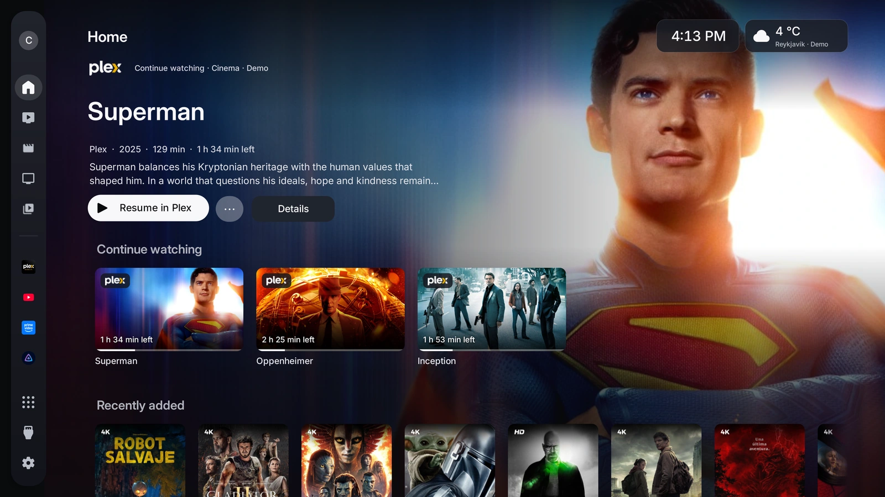
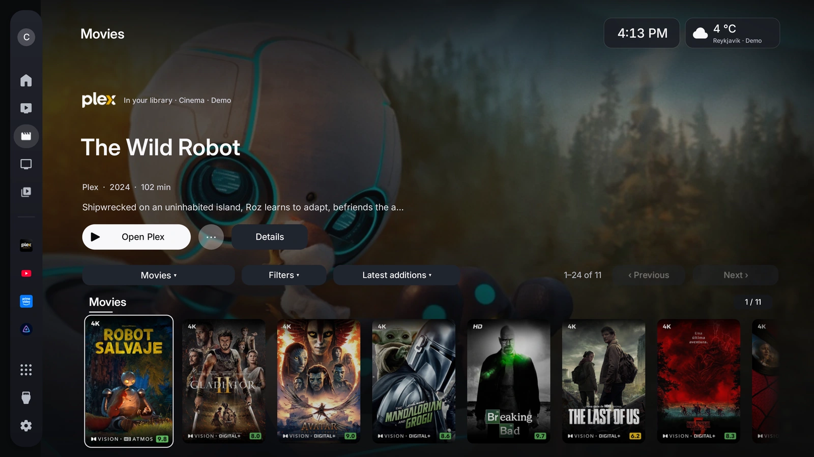
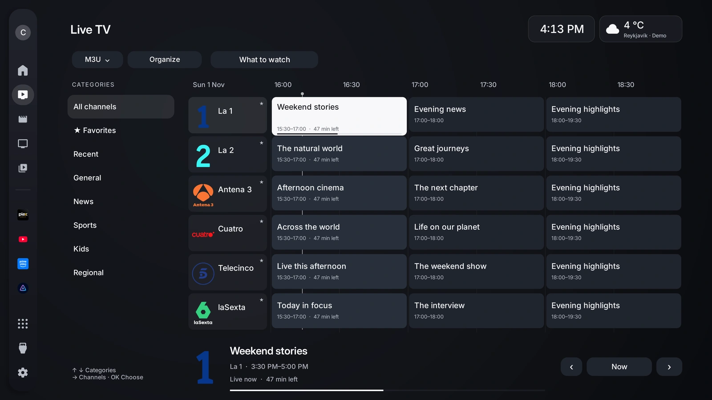
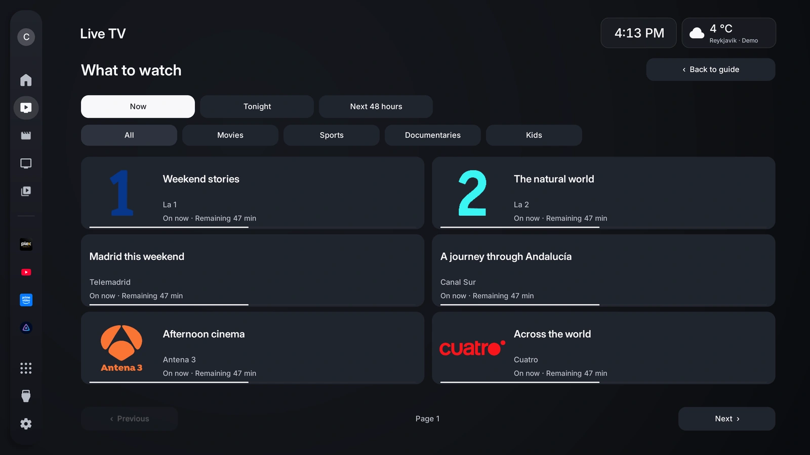
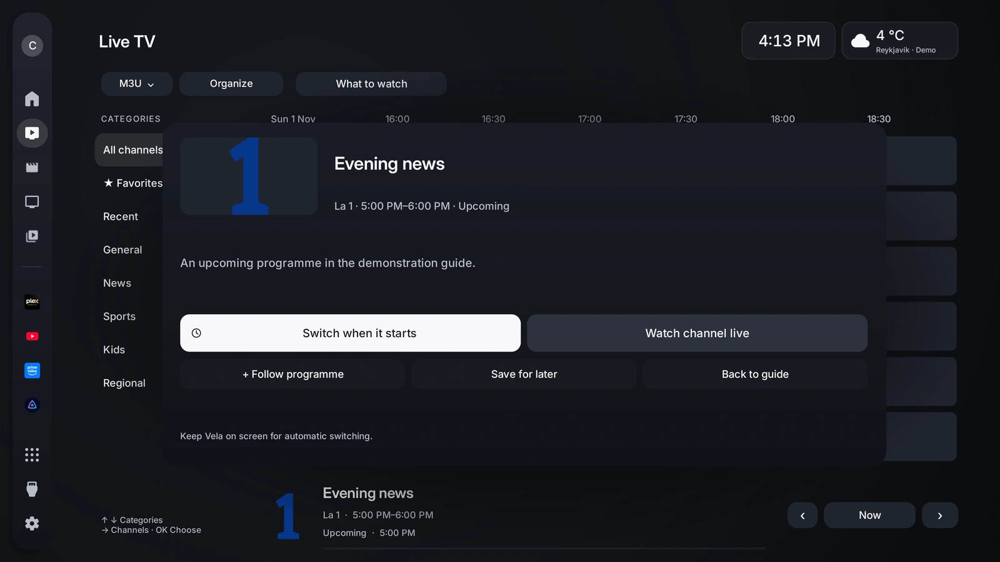
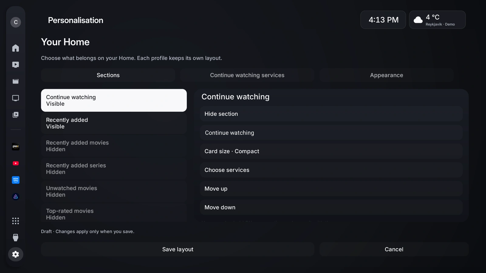
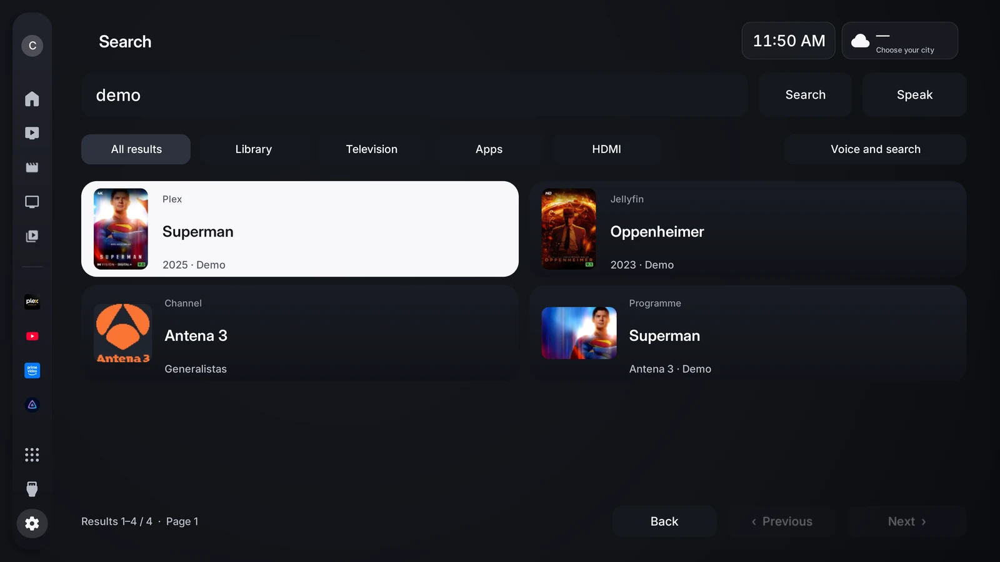
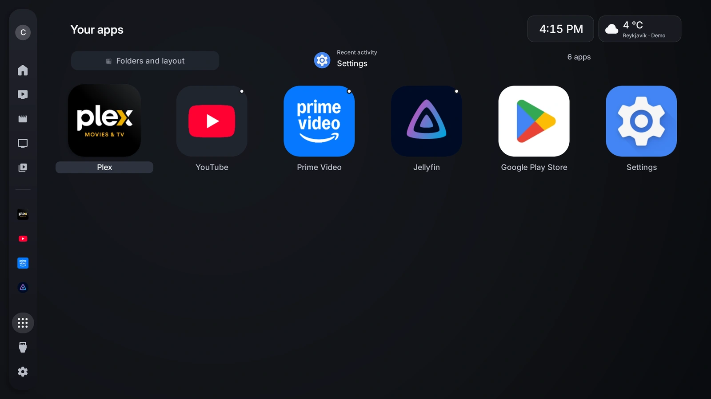
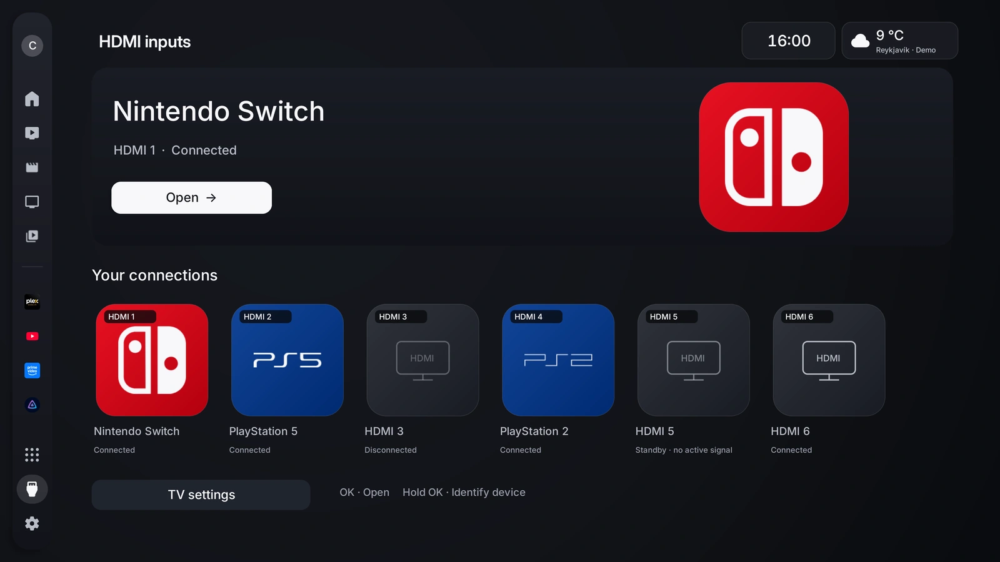
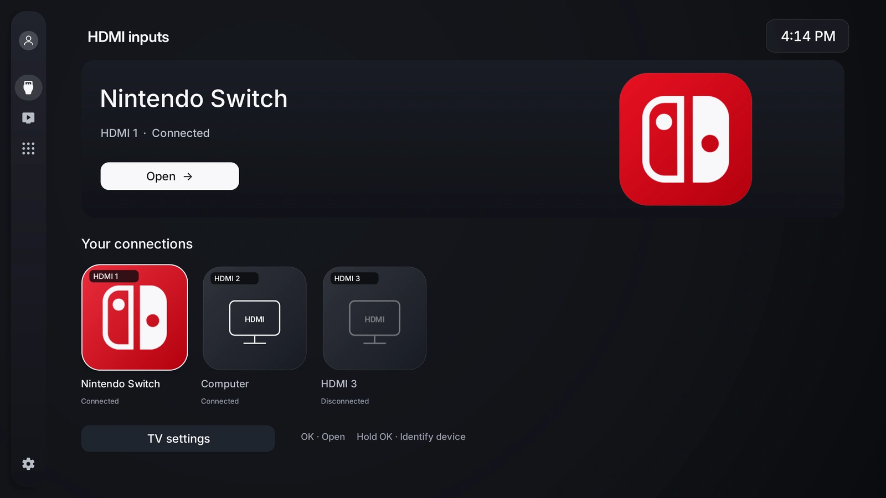

# Vela

### Turn on your TV. Feel at home.

Your films, live channels, apps and HDMI devices — together in a home screen you control.

**[Download Vela](https://github.com/LucasLG92/vela-tv/releases/tag/v2.2.1-preview)** · **[See it in action](gallery/README.md)** · [Get started](guide/INSTALL.md)

**Free & open source · Android TV / Google TV · One APK, Full or Lite · Six languages**

Vela brings your own entertainment to the front. Pick up a film from Plex or Jellyfin, explore the television guide, open a favourite app or switch to your console. The same sidebar and quiet, consistent controls follow you through it all. Vela adds no adverts or sponsored rows.

**[Home](#your-collection-takes-centre-stage)** · **[Live TV](#live-tv-belongs-here-too)** · **[Personalisation](#make-it-your-home)** · **[Lite](#one-download-two-ways-to-use-it)** · **[Install](#start-in-a-few-minutes)**

## Your collection takes centre stage

Connect **Plex, Jellyfin or both**. Your posters and backgrounds become part of Home, with separate Movies and Series libraries and the newest additions first.

- **Carry on where you left off.** Continue watching puts the platform, progress and remaining time inside each card. Choose which connected libraries and compatible apps appear there.
- **Keep your next episode close.** Available Plex On Deck and Jellyfin Next Up episodes join your unfinished titles. Hold OK to mark a film or episode as watched.
- **Build your own shelves.** Recently added, new films, new series, unwatched films, top-rated titles and pinned collections can each have their own place.
- **Browse beyond Home.** Explore the complete library in small pages, with filters supplied by your server. Open a title in its Plex or Jellyfin app.

YouTube, Prime Video and other services can contribute the rows or Watch Next items they share with Android TV. Availability varies by app; Vela does not promise access to private streaming histories. [Library and service compatibility](guide/COMPATIBILITY.md#libraries-and-service-apps).

## Live TV belongs here, too

Your **M3U, Xtream or antenna channels**, in the same place as the rest of your TV. A horizontal guide gives programmes room to breathe, with familiar channel logos, progress, remaining time and what comes next.

Hold OK to manage favourites, put channels in your order or hide what you do not watch. Recent channels and the previous channel stay within reach. While watching, press **Right** to browse channels over the picture.

**What to watch** brings together programmes on now, tonight or in the next 48 hours, using the genres in your guide. Choose a future broadcast and ask Vela to **switch when it starts**, while Vela stays open.

| Find something on tonight | Choose what happens when it starts |
| --- | --- |
|  |  |

Full mode can fall back to another confidently matched signal if a channel fails. Correct a channel's EPG match or time offset yourself. Supported clear HLS streams can use optional local pause and rewind; archives require a source that provides them. Antenna playback and pause depend on the television's tuner. [Set up live TV](guide/IPTV.md) · [Player controls](guide/PLAYER.md).

## Make it your Home

Arrange, rename, resize or hide your Home shelves. Pick the source for each library row and choose Continue watching services independently. Keep a cinema backdrop, use a compact layout or give the whole screen to your rows. Each local profile remembers its own choices.

**Your remote.** Pin apps to the sidebar, hold OK to move or remove shortcuts, and assign available buttons to your own short-press and long-press actions. Bind Vela voice search to a button; a subtle light around the sidebar responds while you speak.

**Your glanceable information.** Choose and arrange up to four widgets: time, weather, date, an upcoming followed programme or useful shortcuts. Reading size, contrast, guide density, margins and reduced motion help Vela fit your screen.

**Your way to set it up.** Use the remote, or start a temporary local phone session from a QR code. Profiles, app folders, preference backups and optional paired-TV preference sync help keep your setup organised. Accounts and provider credentials stay on their own device.

[Explore personalisation](guide/YOUR-VELA.md) · [Home and voice search](guide/HOME-AND-VOICE.md)

## Find it by sight or voice

Recognise films by their posters and channels by their logos. Search Plex, Jellyfin, TV, apps and HDMI in one remote-friendly view, with artwork loaded only for the page you see. Voice feedback follows the sidebar, or becomes a compact microphone capsule on screens without it.

[See voice search without the sidebar](gallery/146-voice-no-sidebar.webp) · [What changed in 2.2.1](guide/releases/2.2.1-preview.md) · [Artwork efficiency measurements](guide/OPTIMIZATION.md)

## Apps and devices, instantly familiar

Large original app icons, useful folders and a sidebar that opens when you need it. Press OK on a pinned app to launch it; hold OK to rearrange your shortcuts without uninstalling anything.

| Your apps | Your connected devices |
| --- | --- |
|  |  |

Consoles, TV boxes, PCs and Macs get recognisable brand icons when Android supplies their identity. Unknown or inactive devices retain their HDMI port label. You can choose a device profile manually; connection state still comes from the TV. [HDMI detection explained](guide/HDMI.md).

## One download. Two ways to use it.

Choose your mode when Vela first opens. You can switch later from **Settings → System → Launcher mode**.

| | **Full** | **Lite** |
| --- | --- | --- |
| Best fit | Your main entertainment home | A TV used with a box, console or computer |
| Android version | 11 or newer | 8.0 or newer |
| Home | Plex/Jellyfin shelves, apps and devices | HDMI, antenna TV and apps |
| Live sources | M3U, Xtream and antenna | The television's own antenna |
| Shared essentials | Guide, favourites, apps, folders, HDMI, profiles, phone setup, reading options, remote shortcuts, backups and updates | The same essentials |
| Screensaver | Aerial video or your library artwork | Your television's screensaver |

Lite leaves Full's multimedia Home, library clients and IPTV player inactive. Both modes use the same APK and update channel. Existing standalone Lite users have an [explicit migration path](guide/UNIFIED.md#moving-from-the-old-standalone-lite-app).

**[Explore Lite →](lite/README.md)** · [Which launcher fits your setup?](guide/WHY-VELA.md)

## Start in a few minutes

1. **[Download the official APK](https://github.com/LucasLG92/vela-tv/releases/tag/v2.2.1-preview)** and install it on your Android TV or Google TV device.
2. **Choose Full or Lite.** Link your own media accounts, configure your channels or open your HDMI devices.
3. **Make it yours.** Choose your Home shelves and sidebar apps, then use Vela's Home-screen setting if you want it as your default launcher.

**[Installation and recovery guide](guide/INSTALL.md)** · [Compatibility](guide/COMPATIBILITY.md) · [Troubleshooting and bug reports](https://github.com/LucasLG92/vela-tv/issues)

All menus support **English, Español, Português, Français, Deutsch and Italiano**, or follow the system language. Library titles and channel names keep their original text.

## Thoughtful about resources. Clear about your data.

Vela uses bounded artwork caches, paged libraries and guides, cancelled stale requests and a single active player or tuner session. Home has no background video. Lite starts only its essentials. [How resource limits work](guide/COMPATIBILITY.md#memory-and-lifecycle).

No Vela account is required. Each install starts without personal accounts, IPTV credentials or a saved location. Backups and preference sync exclude account tokens, provider URLs, location and viewing history. Optional services contact their own hosts when you use them. [Privacy details](guide/PRIVACY.md).

**Updates come to your TV.** Vela can check GitHub and download updates automatically. It verifies the APK before opening Android's installer and clears completed updater downloads afterwards. Android still asks you to confirm installation.

## A few things to know

<strong>Does Vela include films, paid channels or streaming subscriptions?</strong>

No. Connect your own Plex/Jellyfin server and authorised channel sources. Plex and Jellyfin titles open in their respective apps; direct live-TV sources play inside Vela. Streaming services keep their own sign-in and subscriptions.

<strong>Will it work on my television or TV box?</strong>

Vela supports Android TV and Google TV. Lite requires Android 8.0+, Full Android 11+. A box cannot expose a separate television's built-in tuner or HDMI inputs. Home buttons, HDMI/CEC and antenna capabilities depend on the manufacturer. Vela is currently a preview; check the [compatibility guide](guide/COMPATIBILITY.md) and try recovery to your original Home screen.

<strong>Can I use Plex and Jellyfin together?</strong>

Yes. Keep both connected, choose a combined library or select sources per Home row. Continue watching has its own service choices. Other apps appear only when they share compatible Android TV information.

<strong>Are the screenshots real?</strong>

Yes. The current gallery is captured from Vela's production Android views in an owned emulator, with original artwork and documented demonstration accounts, schedules and devices. It does not certify reception or every manufacturer's hardware. [Gallery and credits](gallery/README.md).

## Help shape Vela

If Vela belongs on your TV, **give the project a star** so more people can find it. Try the preview, share a screenshot of your setup, or report a reproducible issue with your device and Android version. Please leave credentials and private server links out of public reports.

[All features](guide/FEATURES.md) · [Changelog](CHANGELOG.md) · [Build from source](guide/BUILD.md) · [Contribute](CONTRIBUTING.md) · [Media kit](guide/MEDIA-KIT.md) · [Watch a real TCL walkthrough](media/tcl/README.md)

---

MIT-licensed. Derived from [Free My TV](https://github.com/simbasjungles/free-my-tv), with its original notices preserved. App names, marks and screenshot artwork belong to their owners. Vela is independent of Apple, Plex, Jellyfin, Google, Amazon and device manufacturers. [Credits and licences](NOTICE.md).
