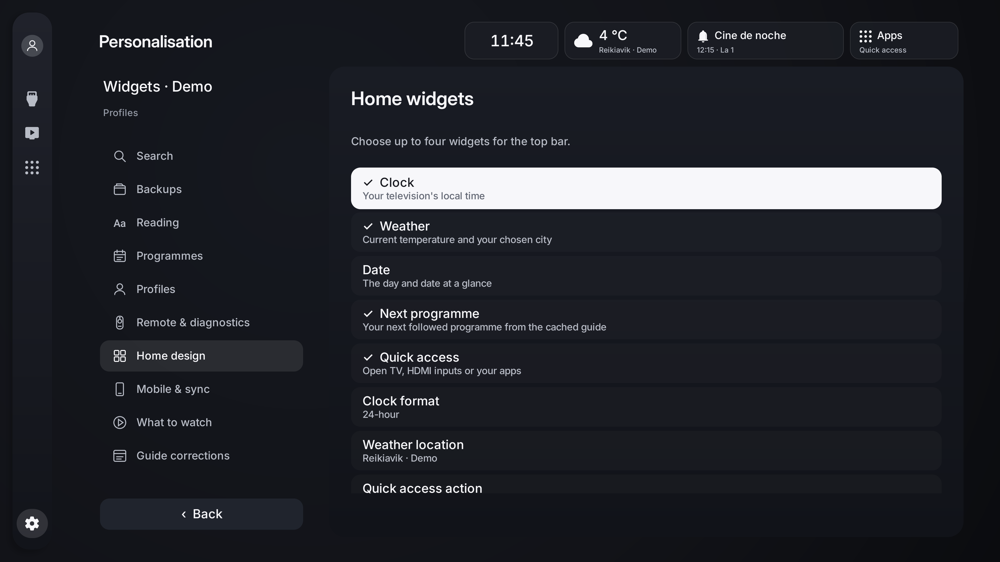
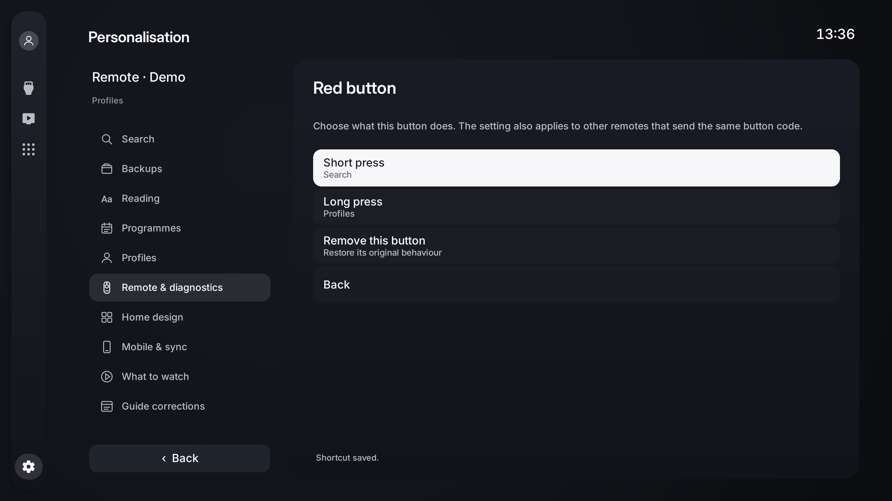
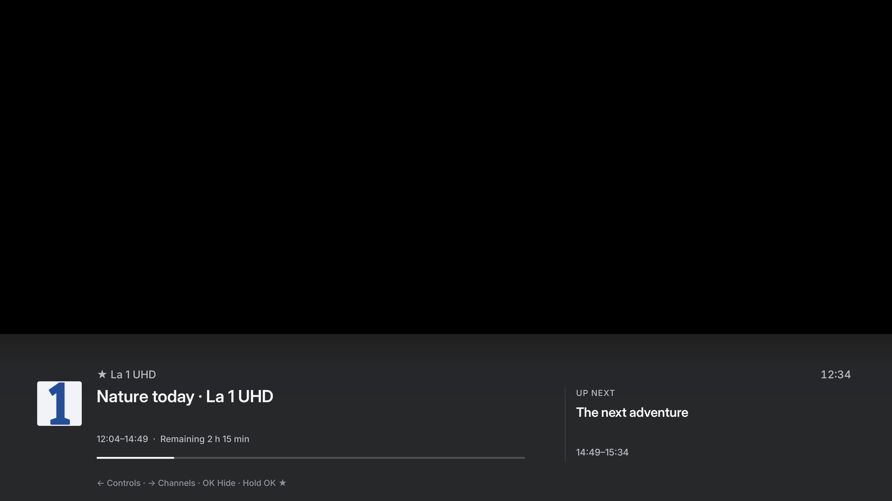
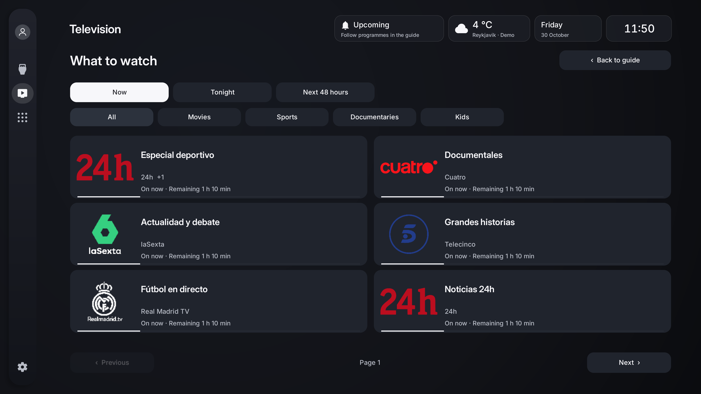
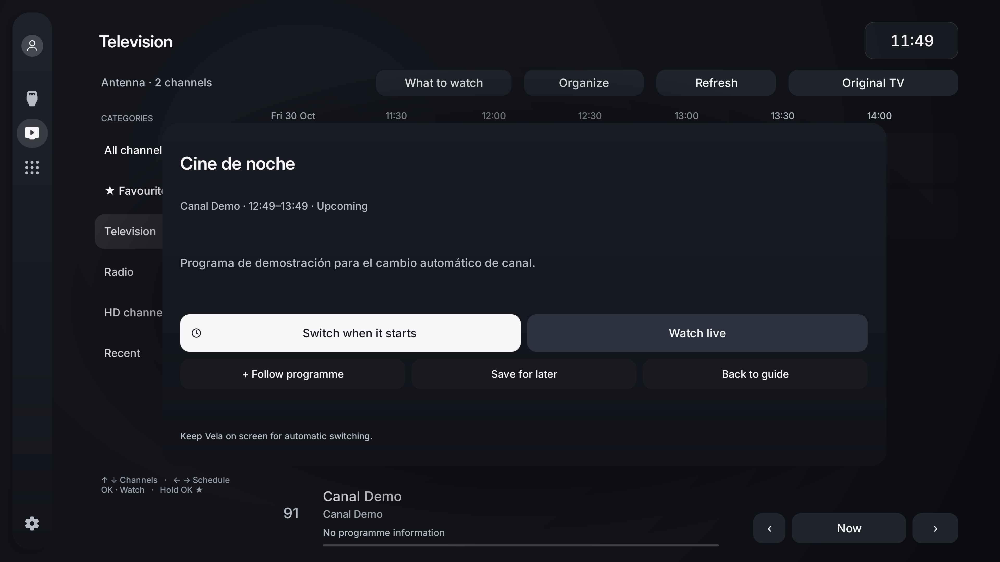
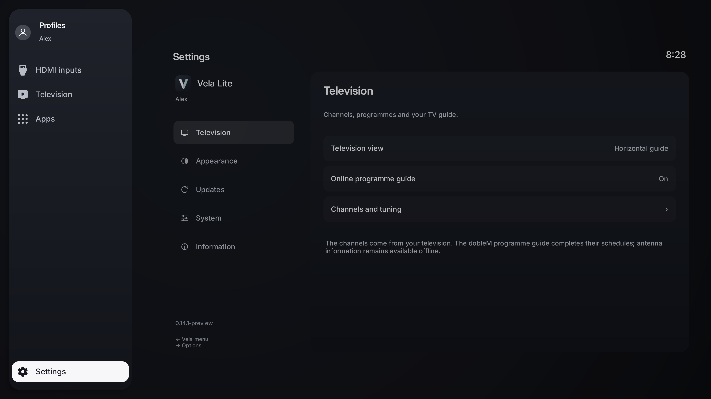

# Vela Lite

### Your television. The essentials, beautifully placed.

Your **HDMI devices, antenna television and apps**, in a clean home screen made for your remote. Vela Lite is for the television that sits alongside a TV box, console or computer.

**[Download Vela Lite](https://github.com/LucasLG92/vela-tv/releases/tag/lite-v0.17.2-preview)** · [Gallery](gallery/README.md) · [Installation](INSTALL.md) · [Full Vela](../README.md)

**Android TV / Google TV · Android 8.0+ · English / Español / Português / Français / Deutsch / Italiano · Preview**

[Watch a real television walkthrough of Vela Full →](../media/tcl/README.md)

## Useful at a glance

Put a quiet time-only clock, weather, date, your next followed programme or a useful shortcut in the top bar. Weather pairs its symbol with a compact temperature-and-location column. Choose up to four widgets and arrange them in Appearance → Home widgets. Each profile keeps its own choices.

## Your remote, your shortcuts

Give available remote buttons a purpose: open TV, an app, HDMI, Search or Settings with a short press or a long press. Learn each button in the same calm settings interface. Your choices stay private to your profile.

## Put your devices first

Open an HDMI input directly from Vela Lite. Connected consoles, TV boxes, PCs and Macs use brand icons and device profiles; unknown or inactive ports keep their HDMI number. Android supplies the connection state. Hold OK to choose a manual profile without inventing a signal.

## Television with context

A horizontal guide brings channel logos, programmes, remaining time and upcoming broadcasts together. Switch to channel cards if you prefer. Use favourites, TV/radio and HD filters, then open the channel through your television's own tuner.

The public dobleM EPG can complete the schedules of channels already tuned on your TV. Antenna information remains available offline. Vela Lite never adds IPTV channels or changes your television's tuning database.

During a channel, press Right, Up or Down to explore without leaving playback. OK chooses a channel; hold OK opens channel actions, including favourites. CH+/CH− changes channels directly. Back closes the drawer or visible information before returning to the guide.

The shared information strip shows the channel logo, clock, progress and **Up next**. Left first reveals it, then opens audio, supported subtitles, picture format and signal information; MENU is an alternative. A sleep timer can stop Vela playback after 30/60 minutes or at the known end of the programme. Pause is offered only if the television's tuner exposes it to Android.

## Find your next programme

Open **What to watch** from Television. Browse **Now**, **Tonight** or **Next 48 hours**, then choose a genre from your guide. Clear programme cards bring the original artwork or channel logo, channel name, remaining time and progress together.

Pick a future programme in the guide and choose **Switch when it starts**. Vela changes channels at the scheduled time while it remains on screen. Cancel from the same card; programmes missed while Vela is closed or in standby are skipped.

## Your channels, your order

Reorder favourites with OK and the arrow keys. Hide channels or categories, restore them later, revisit recent channels or return to the previous channel. Stable DVB identities, or an unambiguous name fallback, help preserve your choices after retuning.

## Make Lite yours

Settings and tools share the home screen's continuous background, including when you expand the sidebar. In Apps, Recent activity brings your last available app, input or channel within reach.

Choose a black or graphite background, clock visibility, reduced focus motion and your Home destination. Adjust reading size, guide density, contrast and screen margins. Reorder or hide the Inputs, Television and Apps destinations; Settings stays accessible.

Create app folders and separate local profiles. Keep a **Watch later** list of broadcasts, protect settings with a local PIN and offer visitors a separate guest space. Back up your preferences, configure them from your phone through a temporary local HTTPS session, or explicitly pair another Vela for compatible preference sync. Credentials remain on each television.

Every menu is available in **English, Spanish, Portuguese, French, German and Italian**, with a manual selector or automatic system language. The same graphite panels, Inter typeface and focus style run through both editions. Tools remain inside the main sidebar. Voice search uses Android’s recognizer when available; the compatibility assistant explains the capabilities your TV exposes.

## A small job, done well

Lite contains **no Plex, Jellyfin, M3U, Xtream or Media3 runtime**. The tuner handles antenna playback. Small paged lists, recycled rows, local icons and disposable workers keep the launcher focused on its job. It has no background service.

Automatic checks and downloads use Lite's GitHub releases. Downloads are verified before Android asks you to install; completed APKs are cleaned from the updater's private cache. Full and Lite use separate Android packages.

[Player controls](../guide/PLAYER.md) · [All personalisation tools](../guide/YOUR-VELA.md) · [HDMI detection](../guide/HDMI.md) · [Privacy](../guide/PRIVACY.md) · [Development and compatibility](DEVELOPMENT.md)

This preview depends on the HDMI and tuner information your television publishes. It cannot add a tuner to an HDMI box, make an unsupported input selectable or confirm physical reception without an antenna signal.
