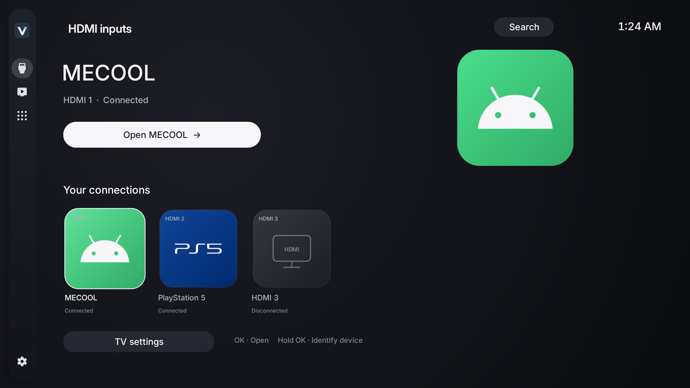
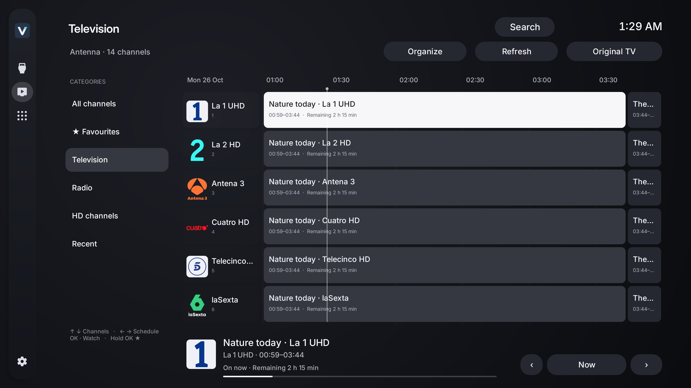
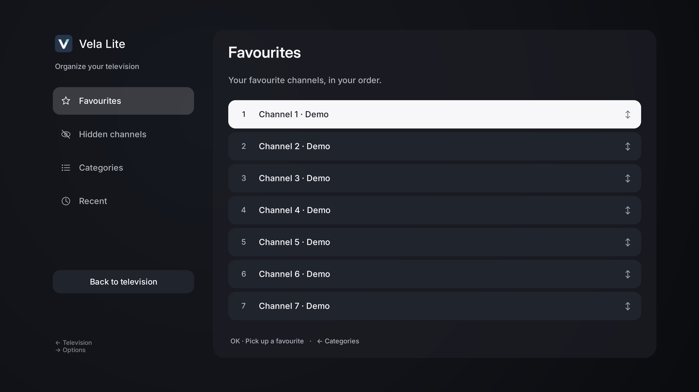
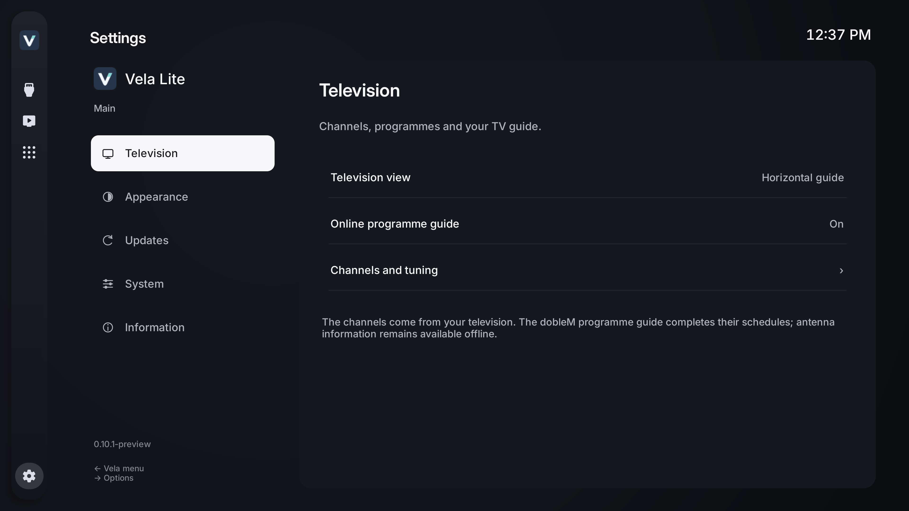

# Vela Lite

### Your television. The essentials, beautifully placed.

Your **HDMI devices, antenna television and apps**, in a clean home screen made for your remote. Vela Lite is for the television that sits alongside a TV box, console or computer.

**[Download Vela Lite](https://github.com/LucasLG92/vela-tv/releases/tag/lite-v0.8.1-preview)** · [Gallery](gallery/README.md) · [Installation](INSTALL.md) · [Full Vela](../README.md)

**Android TV / Google TV · Android 8.0+ · English / Español / Português / Français / Deutsch / Italiano · Preview**

## Put your devices first

Open an HDMI input directly from Vela Lite. Connected consoles, TV boxes, PCs and Macs use brand icons and device profiles; unknown or inactive ports keep their HDMI number. Android supplies the connection state. Hold OK to choose a manual profile without inventing a signal.

## Television with context

A horizontal guide brings channel logos, programmes, remaining time and upcoming broadcasts together. Switch to channel cards if you prefer. Use favourites, TV/radio and HD filters, then open the channel through your television's own tuner.

The public dobleM EPG can complete the schedules of channels already tuned on your TV. Antenna information remains available offline. Vela Lite never adds IPTV channels or changes your television's tuning database.

During a channel, press Right, Up or Down to explore without leaving playback. OK chooses a channel; hold OK adds or removes a favourite. CH+/CH− changes channels directly. Back closes the drawer before returning to the guide.

The on-screen information includes **Up next**. MENU opens audio, supported subtitles, picture format and signal information. Pause is offered only if the television's tuner exposes it to Android.

## Your channels, your order

Reorder favourites with OK and the arrow keys. Hide channels or categories, restore them later, revisit recent channels or return to the previous channel. Stable DVB identities, or an unambiguous name fallback, help preserve your choices after retuning.

## Make Lite yours

Choose a black or graphite background, clock visibility, reduced focus motion and your Home destination. Adjust reading size, guide density, contrast and screen margins. Reorder or hide the Inputs, Television and Apps destinations; Settings stays accessible.

Create app folders and separate local profiles. Back up your preferences, configure them from your phone through a temporary local HTTPS session, or explicitly pair another Vela for compatible preference sync. Credentials remain on each television.

Every menu is available in **English, Spanish, Portuguese, French, German and Italian**, with a manual selector or automatic system language. The same graphite panels, Inter typeface and focus style run through both editions.

## A small job, done well

Lite contains **no Plex, Jellyfin, M3U, Xtream or Media3 runtime**. The tuner handles antenna playback. Small paged lists, recycled rows, local icons and disposable workers keep the launcher focused on its job. It has no background service.

Automatic checks and downloads use Lite's GitHub releases. Downloads are verified before Android asks you to install; completed APKs are cleaned from the updater's private cache. Full and Lite use separate Android packages.

[All personalisation tools](../guide/YOUR-VELA.md) · [HDMI detection](../guide/HDMI.md) · [Privacy](../guide/PRIVACY.md) · [Development and compatibility](DEVELOPMENT.md)

This preview depends on the HDMI and tuner information your television publishes. It cannot add a tuner to an HDMI box, make an unsupported input selectable or confirm physical reception without an antenna signal.
