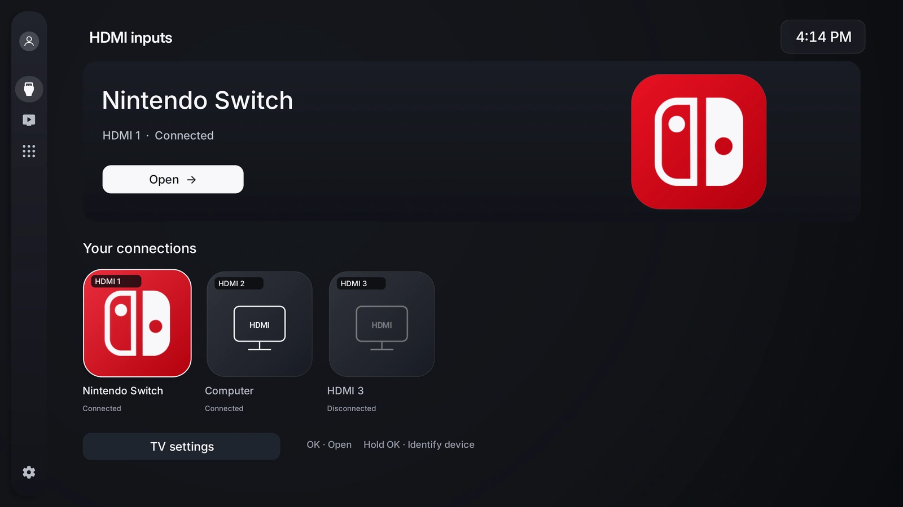
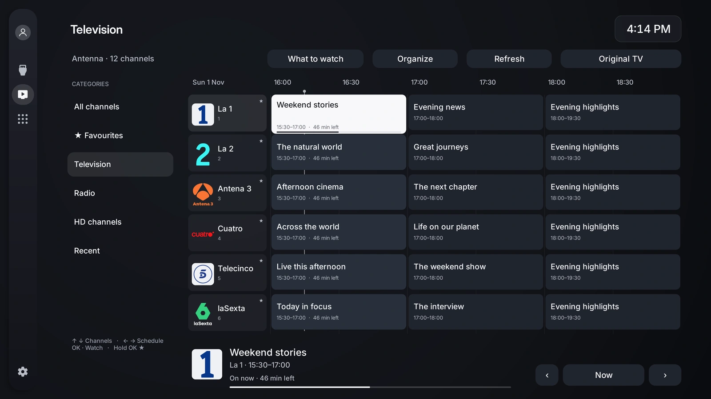
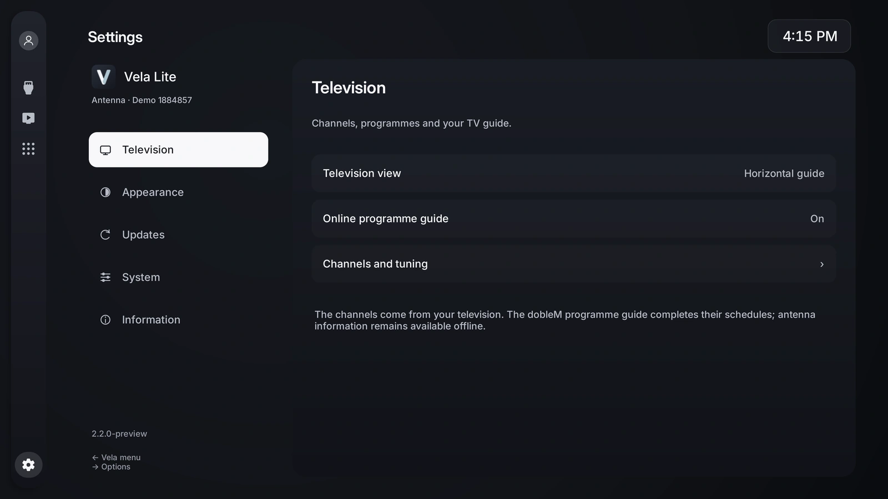
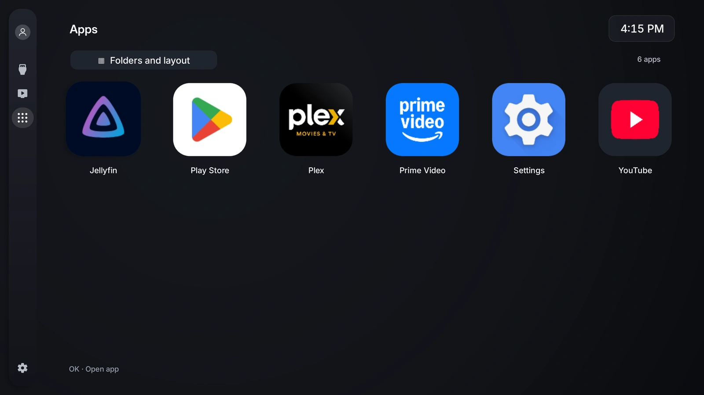

# Vela Lite

### Your TV's essentials. Beautifully within reach.

**HDMI, antenna television and apps**, in the same visual language as Full Vela. Lite is for the television that mainly serves a TV box, console or computer.

**[Download Vela — choose Lite](https://github.com/LucasLG92/vela-tv/releases/tag/v2.3.1-preview)** · **[See the Lite gallery](gallery/README.md)** · [Installation](INSTALL.md) · [Full Vela](../README.md)

**Android TV / Google TV · Android 8.0+ · Six languages · Free & open source · Preview**

## Let your devices take the lead

Open an HDMI input from Home. Connected consoles, TV boxes, PCs and Macs use recognisable brand symbols when Android reports their identity. Unknown or inactive ports keep their HDMI label. Hold OK to choose a manual device profile; the TV still supplies connection state.

Arrange, rename, resize or hide the Inputs, Television and Apps destinations. Choose where Lite starts. The sidebar keeps navigation close without competing with your devices.

## Give antenna television a proper guide

See your tuned channels in a horizontal programme guide, with logos, remaining time, progress and what comes next. Prefer large channel cards? Choose them in Settings.

Hold OK for channel actions. Keep favourites in your order, hide channels or categories, and return to recent channels or the previous one. During playback, press Right, Up or Down to browse; CH+/CH− changes channels directly.

**What to watch** explores programmes on now, tonight or in the next 48 hours. Choose a future programme and schedule a switch while Vela stays open. The public dobleM XMLTV can fill gaps in your tuned channels' schedules; manual EPG matching and time correction help with difficult names.

Lite reads your television's tuning database without rewriting it. It adds no IPTV channels. Actual playback, subtitles, audio controls and pause depend on the manufacturer's tuner. A separate HDMI box cannot expose the screen's tuner to Vela.

## Make the essentials yours

| Settings that feel part of Home | Apps you recognise instantly |
| --- | --- |
|  |  |

Choose up to four widgets for time, weather, date, upcoming programmes or shortcuts. Adjust text size, contrast, guide density, screen margins and reduced motion. Give available remote buttons short-press and long-press actions, including Vela's own voice search. Channel and programme searches show the images supplied by your antenna/guide source. When navigation is hidden, voice uses a compact microphone capsule instead of leaving a detached sidebar outline.

App folders, local profiles, a settings PIN and a guest space help organise a shared television. Use the remote or a temporary local phone session, save a preference backup, or explicitly pair another Vela for compatible preference sync. Accounts and credentials are excluded from those transfers.

Every menu supports **English, Español, Português, Français, Deutsch and Italiano**, or follows Android's language. Settings and tools stay inside the sidebar and the same graphite theme.

[Personalisation guide](../guide/YOUR-VELA.md) · [Remote and voice](../guide/HOME-AND-VOICE.md) · [Player controls](../guide/PLAYER.md)

## One APK, with a smaller job to do

Lite is a mode in the **unified Vela app**. It leaves Full's multimedia Home, Plex/Jellyfin clients and IPTV playback inactive; the shared APK still contains both modes. Small lists, bounded icon caches, a single tuner session and workers released on exit keep Lite focused on its job. These design limits are not a total-RAM benchmark.

Choose Lite on first launch, or switch from **Settings → System → Launcher mode**. Android 8–10 supports Lite; Android 11+ can also use Full. Both modes check and download the same signed GitHub update. Android confirms installation, and Vela clears completed updater downloads afterwards.

Already using the separate old Lite app? Its [0.18.6 transition update](https://github.com/LucasLG92/vela-tv/releases/tag/lite-v0.18.6-preview) supports an explicit import into unified Vela. [Migration steps](../guide/UNIFIED.md#moving-from-the-old-standalone-lite-app).

**[Install Lite](INSTALL.md)** · [Hardware limits](../guide/COMPATIBILITY.md) · [Development](DEVELOPMENT.md) · [Privacy](../guide/PRIVACY.md)

---

If Lite makes your television easier to use, **star [Vela on GitHub](https://github.com/LucasLG92/vela-tv)** and share your device feedback. Vela is a preview; Home-button behaviour, HDMI and native TV support vary by firmware. [Credits and licences](../NOTICE.md).
