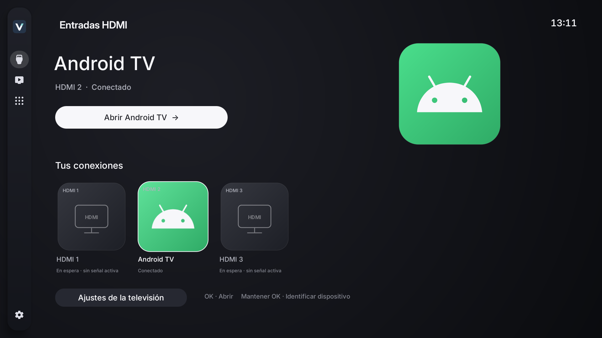
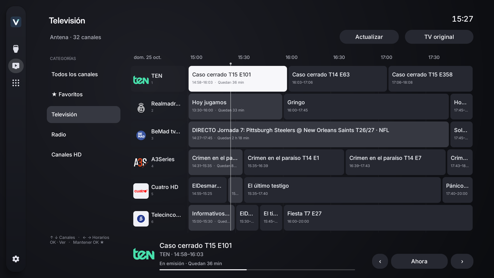
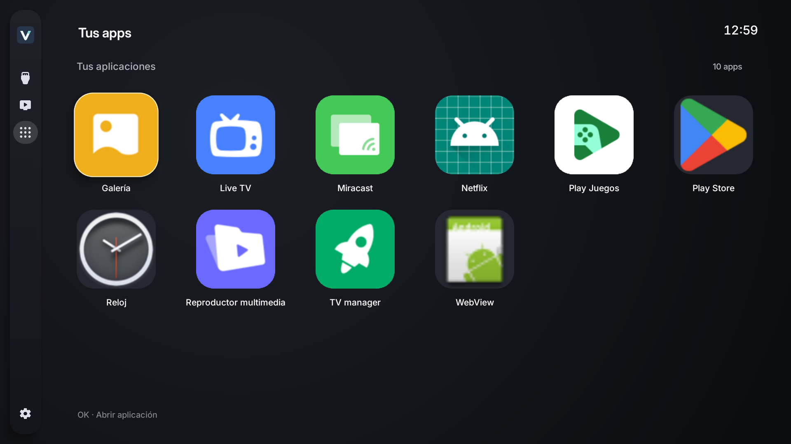
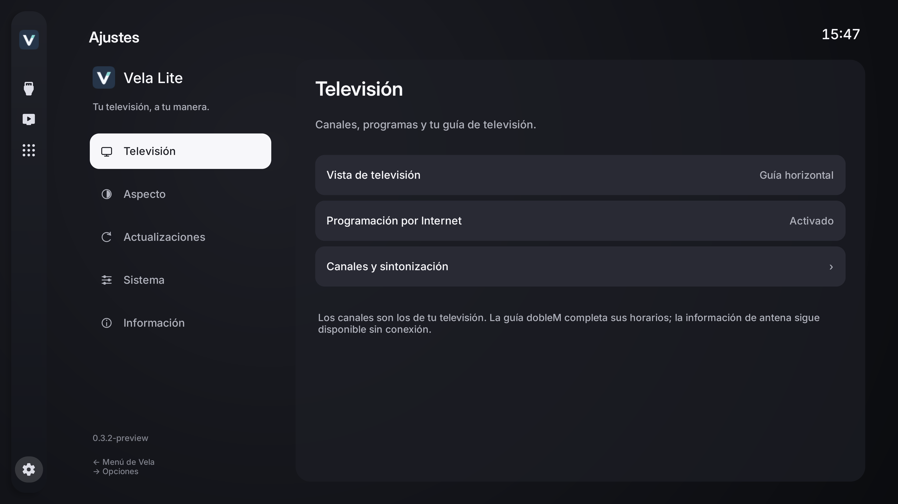
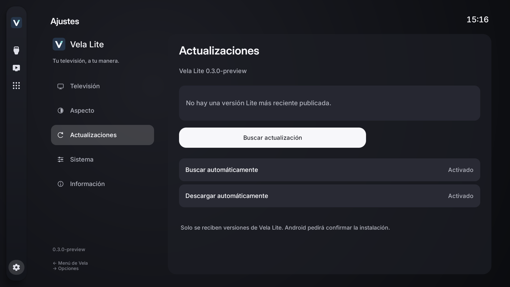
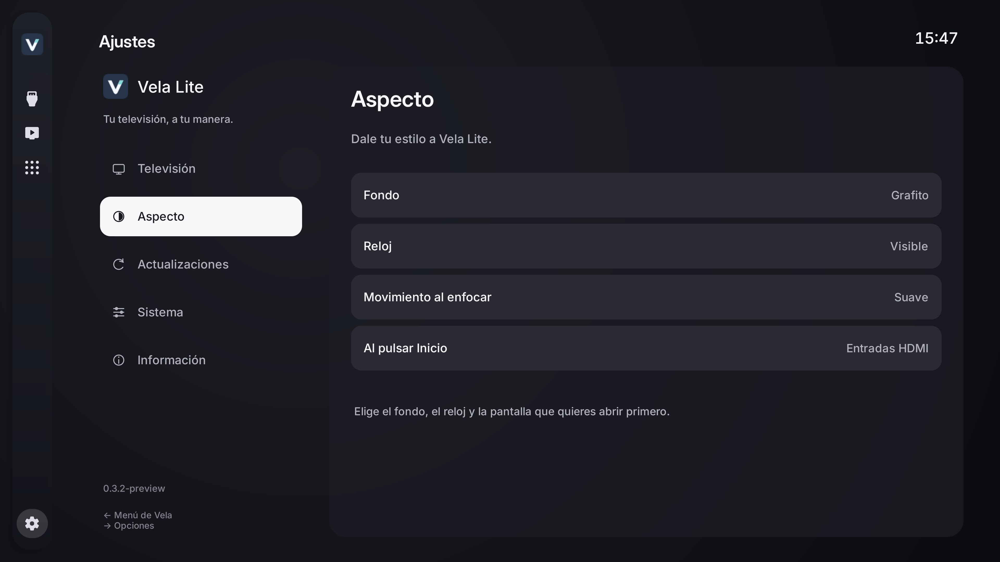
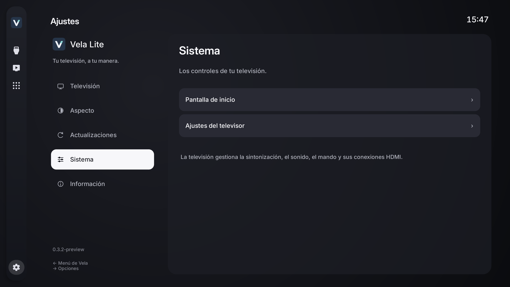
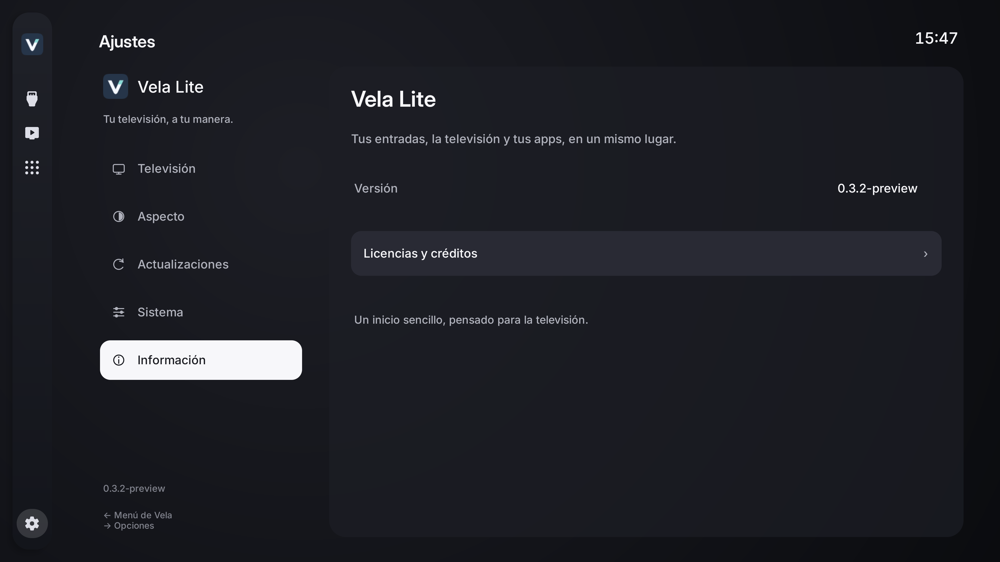

# Vela Lite, en imágenes

Ocho pantallas para descubrir un inicio pensado para la televisión. Capturas nativas en Full HD y 4K, sin datos de cuentas ni conexiones personales. Los canales y las aplicaciones disponibles dependen de cada televisor.

## Tus dispositivos, en primera fila

Entradas HDMI con identificación, estado de conexión y acceso directo.

## La televisión, con contexto

Guía horizontal, programas actuales y siguientes, horarios y tiempo restante.

## Tus aplicaciones, a mano

Cajón de aplicaciones con iconos nativos y navegación con el mando.

## Todo en su sitio

Ajustes agrupados por categorías, con opciones alineadas en el tema de Vela.

## Siempre al día

Búsqueda y descarga automáticas de nuevas versiones de Vela Lite.

## Dale tu estilo

Fondo grafito o negro, reloj, movimiento y pantalla inicial.

## Los controles de tu televisión

El inicio y los ajustes del televisor, a un paso.

## Conoce tu Vela Lite

Versión e información, en el mismo panel.

[Descargar Vela Lite](https://github.com/LucasLG92/vela-tv/releases/tag/lite-v0.5.1-preview) · [Volver a la presentación](../README.md)
