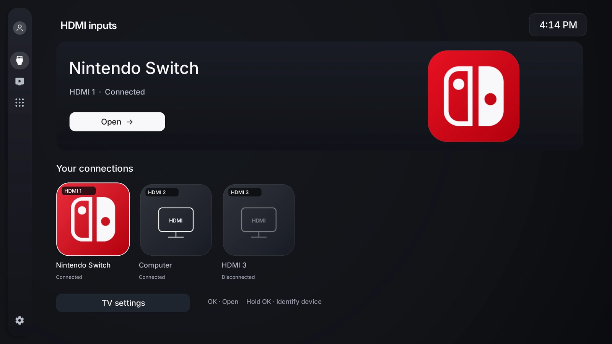
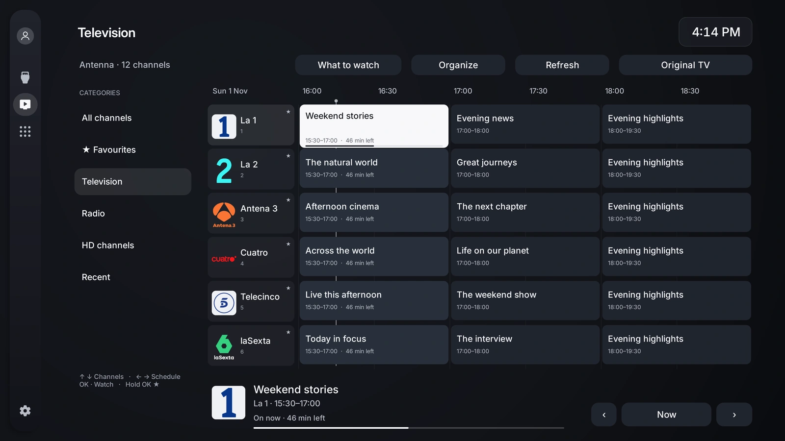
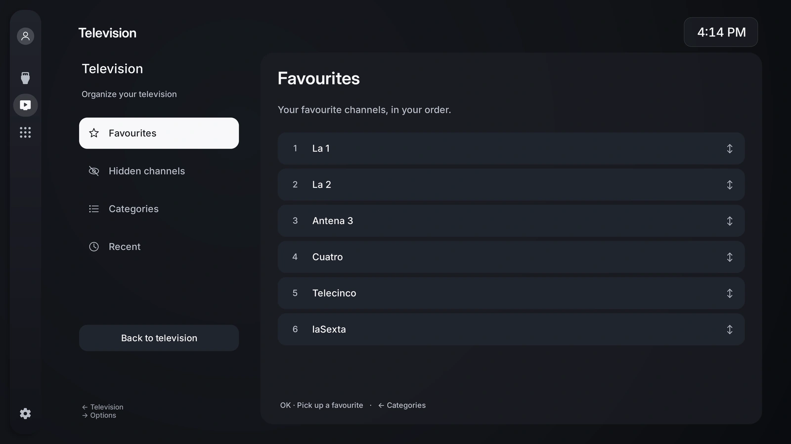
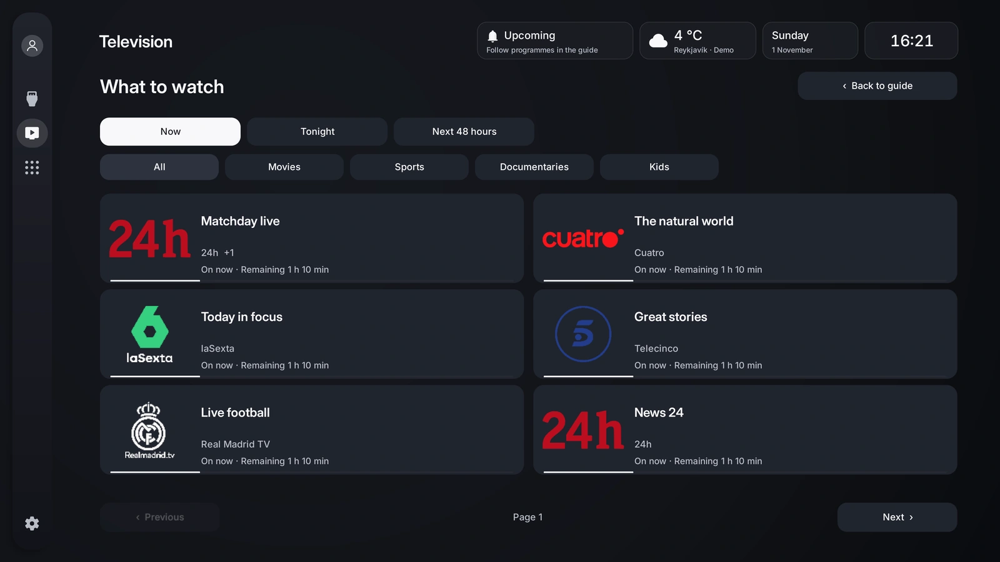
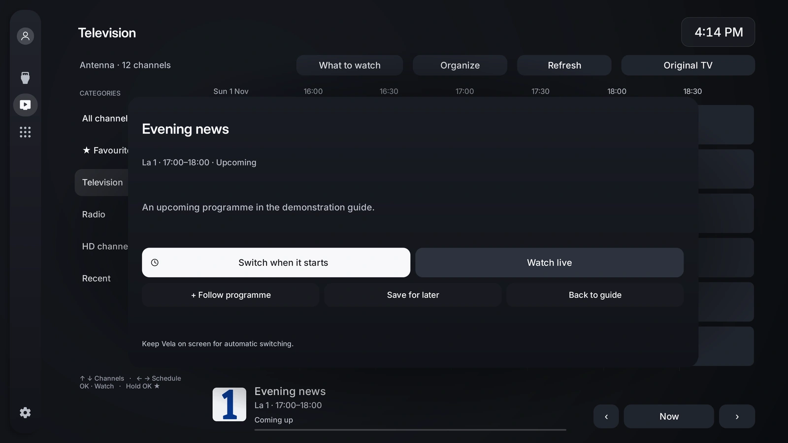
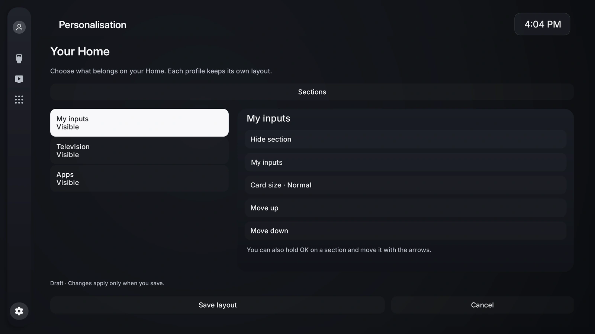
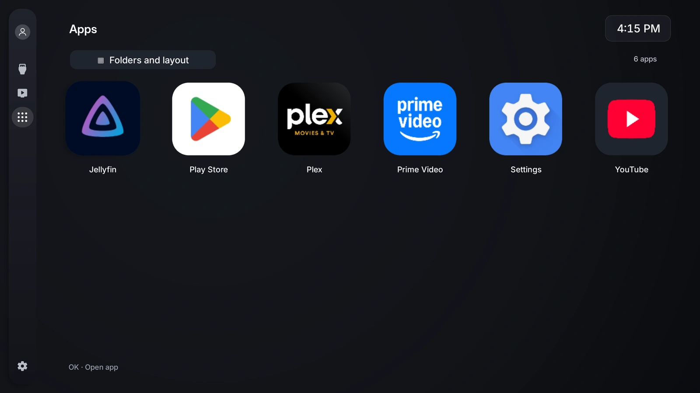
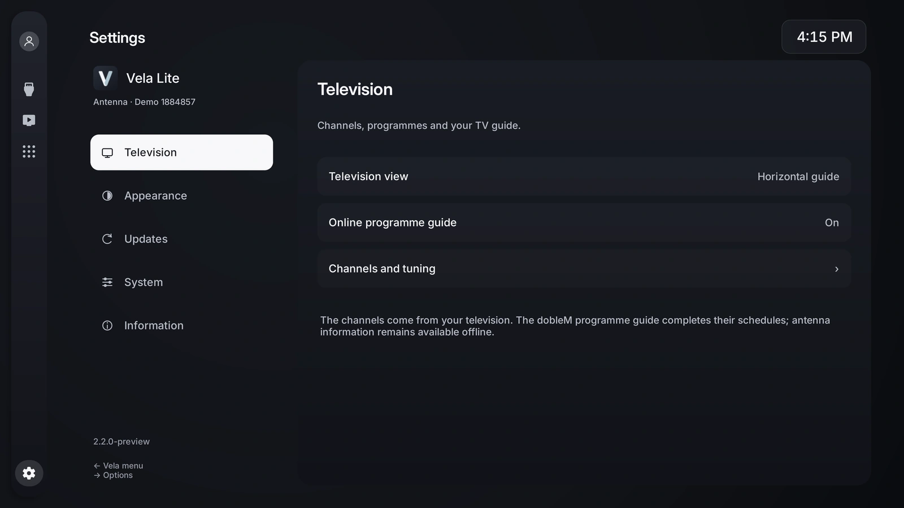

# Vela Lite, in pictures

**Eight new native 4K captures from Lite mode in Vela 2.2.0 Preview.** The same APK and design as Full, focused on HDMI, antenna television and apps.

**[Download Vela — choose Lite](https://github.com/LucasLG92/vela-tv/releases/tag/v2.3.1-preview)** · [About Lite](../README.md) · [Install](../INSTALL.md) · [Full gallery](../../gallery/README.md)

These are production Android views in an owned emulator. HDMI connections, tuner channels and programmes are demonstration fixtures, with original device and channel symbols. They illustrate the interface, not a physical signal or a broadcaster's actual schedule. All menus are in English. [Credits](../../gallery/CREDITS.md) · [Current capture records](../../gallery/index.json).

## Put your devices first

Open your box, console or computer from a calm HDMI Home. Connection state still comes from the television; manual profiles do not create a signal.

## Give your tuned channels a proper guide

Channel logos, programmes, remaining time, progress and upcoming broadcasts in one place. The television's tuner provides playback.

| Keep channels in your order | Find a programme |
| --- | --- |
|  |  |

Select a future programme to follow it, save it or ask Vela to switch when it starts while Vela is open.

## Keep Home personal

Rename, size, reorder or hide Inputs, Television and Apps. Save applies your choices; Cancel keeps your current setup. Settings stays accessible.

| Apps you recognise | Settings in the same theme |
| --- | --- |
|  |  |

Widgets, remote shortcuts, profiles, phone setup, backups and compatible preference sync use Vela's shared tools. [Explore personalisation](../../guide/YOUR-VELA.md).

---

[Previous standalone Lite gallery](ARCHIVE.md) and its [legacy manifest](index.json) remain available as a record of earlier releases. New users install unified Vela and choose Lite. [Migration from the old package](../../guide/UNIFIED.md#moving-from-the-old-standalone-lite-app).

[Back to Lite](../README.md) · [Hardware limits](../../guide/COMPATIBILITY.md) · [Full gallery](../../gallery/README.md)
