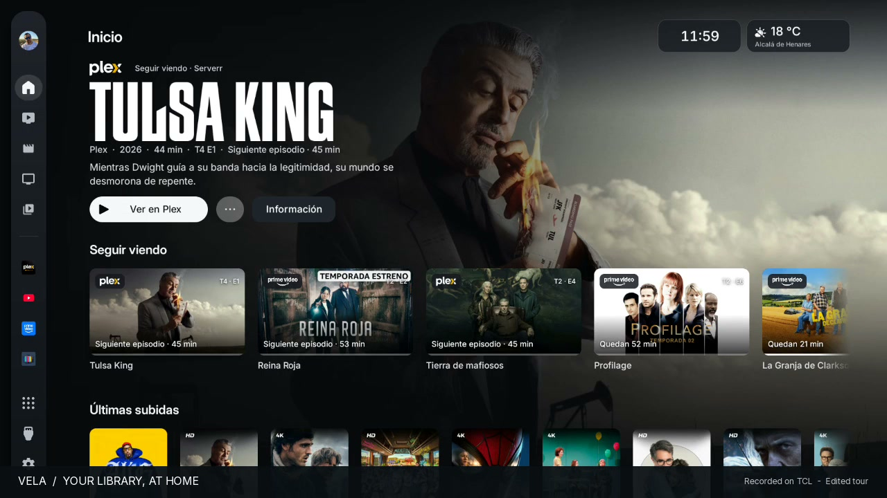

# Vela, on a real television

One minute of **Vela Full 1.38.2** running on a TCL Android TV: Continue watching, Recently added, the live guide, future programme actions and What to watch.

**[Watch or download the video](vela-demo.mp4)** · [Download Vela](https://github.com/LucasLG92/vela-tv/releases/tag/v1.38.2-preview) · [Vela Lite](../../lite/README.md)

This is an edited recording of the installed public release, with Spanish menus and English chapter titles. The owner's profile image, server display name, library artwork and chosen weather location appear with permission. Account and source configuration screens, passwords, tokens and provider credentials are excluded.

The video is a silent 720p H.264 file. [Capture metadata and checksum](video.json). The [main screenshot galleries](../../gallery/README.md) use demonstration data; this video uses the owner's television.
